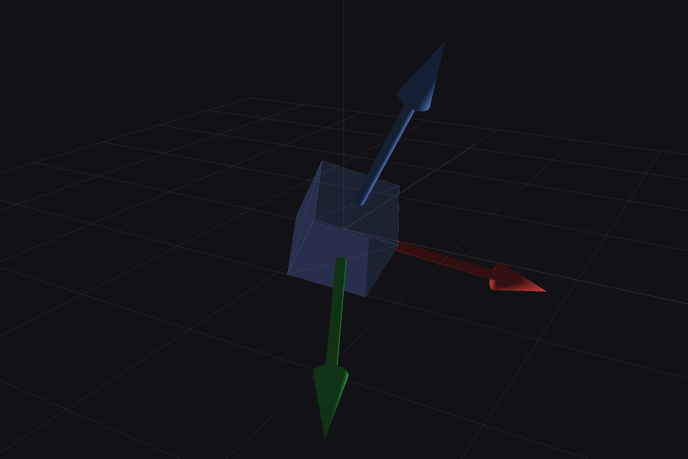

# WT901WIFI 姿态 3D 可视化

读取 WT901WIFI 的姿态角，并在屏幕上实时绘制**随传感器转动的三条轴线**。



*（预览为 roll=25°, pitch=20°, yaw=35° 时的画面）*

---

## 效果说明

| 元素 | 含义 |
|---|---|
| 🔴 **红箭头** | 传感器 **X 轴** |
| 🟢 **绿箭头** | 传感器 **Y 轴** |
| 🔵 **蓝箭头** | 传感器 **Z 轴** |
| 半透明立方体 | 传感器本体 |
| 灰白网格 + 暗色细线 | 静止的**世界参考系**（Z 轴竖直向上） |

设备水平静置时，蓝色 Z 轴竖直向上；转动设备，三条轴线跟着一起转。

---

## 安装

依赖只有 5 个包，都是预编译 wheel，无需编译：

```bash
conda activate wt901
pip install -r wt901_viz/requirements.txt
```

> 已在 `wt901` 环境装好：`pyqtgraph 0.14`、`PyOpenGL 3.1.10`、`PySide6 6.11`、`numpy`、`pyserial`。

---

## 运行

```bash
conda activate wt901
cd /home/hzb/Work/WT901

python wt901_viz/viewer.py                       # 读 /dev/ttyUSB0 @9600
python wt901_viz/viewer.py --port /dev/ttyUSB1   # 指定串口
python wt901_viz/viewer.py --demo                # 不接硬件, 合成姿态演示
python wt901_viz/viewer.py --screenshot a.png    # 渲染一帧存图后退出
```

### 操作

| 操作 | 功能 |
|---|---|
| 鼠标左键拖动 | 旋转视角 |
| 滚轮 | 缩放 |
| 鼠标中键拖动 | 平移 |
| `R` | 复位视角 |
| `C` | 截图（存到当前目录） |
| `Esc` / `Q` | 退出 |

窗口顶部一行实时显示：设备 ID、Roll / Pitch / Yaw、加速度、刷新率、累计包数。

---

## 工作原理

```
/dev/ttyUSB0 ──(9600 8N1)──> SerialAttitudeSource.poll()
                                     │  滑动缓冲 + 找 'WT' 头 + 54 字节 + CRLF 尾
                                     ▼
                              AttitudePacket        （复用 wt901/protocol.py）
                                     │
                                     ▼
                        rotation_matrix(roll,pitch,yaw)
                                     │  R = Rz(yaw)·Ry(pitch)·Rx(roll)
                                     ▼
                        setTransform(QMatrix4x4)  ──> OpenGL 三条箭头
```

**旋转顺序已用加速度计交叉验证**：静止时加速度计测到的"上"方向，必须等于
姿态角推算的 `Rᵀ·(0,0,1)`。实测 **ZYX 顺序误差 0.02°**，而 XYZ 顺序误差明显更大，
所以采用 `R = Rz(yaw)·Ry(pitch)·Rx(roll)`。

可用下面的方式在任意姿态下复核：

```python
from wt901_viz.orientation import best_order
print(best_order(packets))   # 返回 (最佳顺序, {顺序: 平均误差})
```

---

## 已知问题与注意事项

### 1. `QT_QPA_PLATFORM=xcb` 会导致画不出东西（已自动处理）

Qt6 在 X11 下用 EGL，而 PyOpenGL 默认按 GLX 找上下文，会持续报
`Attempt to retrieve context when no valid context`，画面全黑。

本程序启动时会检测：若当前是 Wayland 会话但 `QT_QPA_PLATFORM` 被设成了 `xcb`，
**自动切回 `wayland`** 并打印提示。若要手动指定：

```bash
QT_QPA_PLATFORM=wayland python wt901_viz/viewer.py
```

### 2. 串口输出被固件限制在约 2Hz —— 高频率必须走 WiFi

实测（10 秒计数、多种配置）：

| 项目 | 结果 |
|---|---|
| 串口实际输出 | **2.10 Hz**（113 B/s） |
| 9600 8N1 容量上限 | 960 B/s = 17.8 包/s |
| 改 RATE 寄存器 | 回读生效（100→50→10），**但串口速率不变** |
| 加硬件流控 / 重启 | 无变化 |

结论：**Type-C 串口的"数据打印"速率是固定的 ~2Hz**，RATE 寄存器控制的是
**WiFi 发送速率**。所以想要光滑连续，必须用 WiFi 通道。

WiFi 通道支持 RATE 寄存器配置到最高 **200Hz**：

```bash
python configure.py rate 100        # 设为 100Hz
```

### 3. 姿态精度

现在显示的是**原始姿态角**。Yaw 依赖磁场，受环境干扰明显。要提高精度需先做
加速度零偏校准和磁场校准（见 `../手册中文/WT901WIFI 通信协议.md` 2.2.2.2 节）。

---

## WiFi 无线接收（高频率）

设备推的仍是同样的 54 字节数据包，只是换成 UDP/TCP 传输。
**实测可达 40~180Hz**，串口只有 2.1Hz。

### 方式 A：AP 模式（设备自建热点）—— 已验证可用

设备开机后默认就是 AP 模式，广播一个以设备 ID 命名的开放热点。

**1. 电脑 WiFi 连上设备热点**（如 `WT5500011408`，无密码）

**2. 确认拿到 `192.168.4.2`**

```bash
ip -4 addr show wlp8s0
```

> 设备的默认目标地址就是 `192.168.4.2:1399`，而 DHCP 恰好也把
> `192.168.4.2` 分给第一个客户端，所以**通常不需要握手，数据直接就来了**。
> 若拿到的是别的地址，向 `255.255.255.255:9250` 广播
> `WIT<本机IP>\r\n`，设备会自动把目标切过去。

**3. 启动接收端**

```bash
python wt901_viz/viewer.py --net udp --listen-port 1399
```

**4. 调高频率**（设备拔掉 USB 时用 `--net` 走 WiFi 配置）

```bash
python configure.py --net rate 100
```

### 方式 B：STA 模式（设备连外部路由器）

设备只支持 **WPA2-PSK 的 2.4GHz 网络**：

```bash
python configure.py wifi --ssid "MyWiFi" --password "12345678" \
    --server-ip auto --port 1399 --proto udp
```

### ⚠️ 校园网/企业网连不上

校园网通常是**开放网络 + 网页认证**或 **802.1X 企业认证**，而设备只支持
`WITWIFI:"ssid","password"` 这种 WPA2-PSK 方式：

- 设备没有浏览器，**过不了网页认证**
- 不支持 802.1X 企业认证

所以校园网这条路走不通。可行替代：

1. **手机开 2.4GHz 热点**（WPA2-PSK 普通密码），设备和电脑都连它
2. **用设备的 AP 模式**（方式 A，零额外设备，推荐）
3. 便携路由器

### 配置工具

```bash
python configure.py show            # 读配置（串口）
python configure.py --net show      # 读配置（WiFi, 设备 AP 模式）
python configure.py --net rate 100  # 设回传频率
python configure.py raw 0x25 50     # 直接写寄存器
python configure.py wifi --help     # 设置 WiFi 与服务器
```

> 写寄存器前会自动解锁（写 `0xB588` 到 `0x69`）。**解锁后必须等待约 0.6s
> 再写**，否则写入静默失败（这个坑已踩过并修好）。

### 实测速率（关闭 WiFi 省电后）

| RATE 设定 | 实测收包率 | 界面显示 |
|---|---|---|
| 10Hz（出厂） | 9.3 Hz | — |
| 100Hz | **98.8 Hz** | **99~101 Hz，欠载 0%** |
| 200Hz | 180.5 Hz | — |

---

## 卡顿排查与调优（重要）

如果你遇到「丢包 / 间歇性卡顿」，按下面两条排查。两条都实测验证过。

### 根因 1：WiFi 省电模式 —— 必须关闭

**这是最主要的原因。** 省电模式下无线网卡会周期性休眠，AP 把数据帧缓冲
后**突发送达**，导致既丢包又抖动：

| 指标 | 省电 ON | 省电 OFF |
|---|---|---|
| 收包率 | 68.8 Hz | **98.8 Hz** |
| 到达间隔 p99 | 228.7 ms | **25.5 ms** |
| 到达间隔 max | 548.7 ms | **144.5 ms** |
| 设备时间戳间隔 p99 | 120 ms | **10 ms** |

关闭方法（不需要 sudo，用 NetworkManager 即可）：

```bash
./fix_wifi_powersave.sh
```

或手动：

```bash
nmcli connection modify "<你的WiFi连接名>" wifi.powersave 2
nmcli device reapply wlp8s0
```

> 该设置会持久保存到该 WiFi 的连接配置里；**换到别的 WiFi 要重新执行**。

### 根因 2：数据到达抖动 —— 已用抖动缓冲解决

即使关闭省电，设备（AP 模式下 ESP32 同时当热点+采集+发包）偶尔仍会有
100~150ms 的停顿。如果直接显示「最新收到的包」，画面就会一顿一顿。

程序内置了**抖动缓冲（jitter buffer）**：固定滞后 `--delay` 毫秒回放，
中间做角度插值（走最短路径，处理 ±180° 回绕）。这样只要缓冲里还有数据，
画面就是匀速连续的；缓冲耗尽时停在最后姿态，不会乱跳。

```bash
python wt901_viz/viewer.py --net udp --delay 80    # 默认 80ms
```

- `--delay` 越大越平滑，但滞后越明显
- 关闭省电后 80ms 已足够（实测欠载 0%）
- 若仍偶有停顿，可加到 120~200ms

### 诊断工具

```bash
python wt901_viz/viewer.py --net udp --stats
```

每秒输出：收包率、定时器间隔 p50/p99/max、缓冲欠载率、队列深度。
正常应看到：收包率≈设定值、p99≈17ms、欠载 0%、队列 0。

---

## 文件说明

```
wt901_viz/
├── viewer.py            # 主程序: 3D 可视化窗口 (串口 / WiFi)
├── orientation.py       # 欧拉角 -> 旋转矩阵, 及旋转顺序验证工具
├── requirements.txt
├── docs/preview.png
└── README.md

wt901/                   # 数据与协议核心
├── protocol.py          # 54 字节数据包解析 (串口/WiFi 共用)
├── serial_source.py     # 串口读取 + 容错分包 (2Hz 上限)
├── net_source.py        # WiFi TCP/UDP 接收 (最高 200Hz)
├── registers.py         # 寄存器读写协议 (解锁/读/写/保存/设频率)
└── transport.py         # 把寄存器协议映射到 UDP (免串口配置)

configure.py             # 配置工具: show / rate / raw / wifi
fix_wifi_powersave.sh    # 关闭 WiFi 省电模式 (解决丢包/卡顿的根因)
read_attitude.py         # 纯文本实时读数 + CSV 记录
```

---

## 后续可扩展

- 换用四元数（寄存器 `0x26~0x29`）避免欧拉角万向节死锁
- 叠加加速度/角速度实时曲线
- 增加校准按钮（解锁、加计校准、磁校准、校时）
- 用 `transport.py` 把校准也做成免串口的 WiFi 操作
