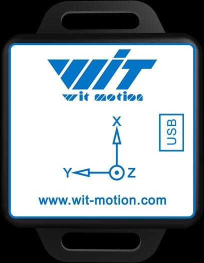
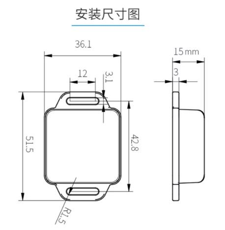
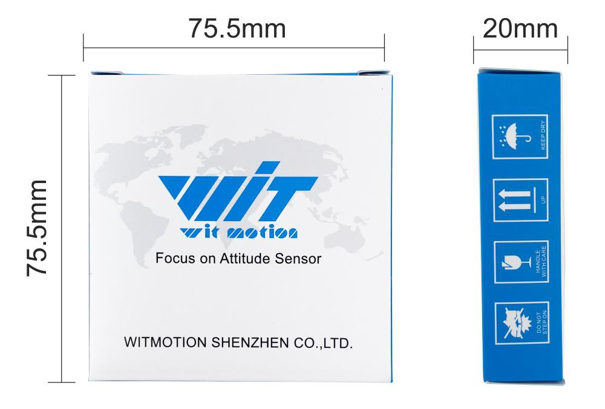

# WT901WIFI 产品规格书

> **原文**：《WT901WIFI Product Specifications》（www.wit-motion.com，共 12 页）
> **说明**：本文档为英文原版手册的完整中文翻译。原文中的插图已提取到 `images/` 目录并在对应位置引用。
> 专业术语首次出现时保留英文原文，便于与原 PDF 对照。

---

## 目录

1. 产品介绍
   - 1.1 产品概述
   - 1.2 产品特点
2. 技术参数
   - 1.1 加速度计参数
   - 1.2 陀螺仪参数
   - 1.3 磁力计参数
   - 1.4 横滚角与俯仰角参数
   - 1.5 航向角参数
   - 1.6 模块参数
     - 1.6.1 基本参数
     - 1.6.2 电气参数
3. 产品尺寸
4. 接口说明
5. 产品包装
6. 应用领域

> 注：原文目录中「技术参数」一章的编号重复使用了「1.」，本译文保留原样。

---

## 1. 产品介绍

### 1.1 产品概述

本产品是一款基于 MEMS 技术的高性能三维运动姿态测量系统。它包含三轴陀螺仪、三轴加速度计、三轴电子罗盘等运动传感器。通过集成多种高性能传感器，配合自主研发的姿态动力学核心算法引擎，并结合高动态卡尔曼滤波融合算法，为客户提供高精度、高动态、实时补偿的三轴姿态角，并通过灵活选择与配置各类数据，满足不同的应用场景需求。

基于卡尔曼滤波原理、具有自主知识产权的领先传感器融合算法，可提供更新率高达 200Hz 的实时数据，从而满足各种高精度应用需求，实现精确的动作捕捉与姿态估计。

我们拥有国内领先的高精度转台设备和仪器，产品集成了自主研发的高精度标定与校准算法，以提升产品的测量精度。

同时，我们为用户提供多种上位机软件、使用说明和开发手册，最大限度地缩短各类需求的研发时间。

### 1.2 产品特点

- 模块集成高精度陀螺仪、加速度计和地磁场传感器，采用高性能微处理器以及先进的动力学解算器和卡尔曼动态滤波算法，能够快速解算出模块当前的实时运动姿态。

- 采用先进的数字滤波技术，可有效降低测量噪声、提高测量精度。

- 模块集成姿态解算器，配合动态卡尔曼滤波算法，能够在动态环境下准确输出模块的当前姿态。姿态测量精度为 0.2°，稳定性极高，性能甚至优于某些专业倾角仪。

- Z 轴航向角加入了地磁传感器滤波融合，解决了 6 轴算法中陀螺仪积分漂移带来的累积误差，能够长时间稳定输出航向角数据。
  **注意：由于涉及磁场检测，使用前需要先进行校准，且使用时必须与磁干扰区域、电子设备、磁铁、扬声器等硬磁物体保持至少 20cm 的距离。**

- 最大数据输出速率为 200Hz。输出内容可任意选择，输出速率在 0.2～200Hz 之间可调。

- 内置 3.7V-260mAh 锂电池，工作电流 80mA，可连续工作 3 小时，充电时间 1 小时。

- 2.4G 频段 WIFI 信号，支持 TCP 和 UDP 自定义连接。

---

## 2. 技术参数

### 1.1 加速度计参数

| 参数 | 条件 | 典型值 |
| --- | --- | --- |
| 量程 | | ±16g |
| 分辨率 | ±16g | 0.0005（g/LSB） |
| RMS 噪声 | 带宽 = 100 Hz | 0.75～1 mg-rms |
| 静态零漂 | 水平放置 | ±20～40 mg |
| 温度漂移 | −40℃ ～ +85℃ | ±0.15 mg/℃ |
| 带宽 | | 5～256 Hz |

### 1.2 陀螺仪参数

| 参数 | 条件 | 典型值 |
| --- | --- | --- |
| 量程 | | ±2000°/s |
| 分辨率 | ±2000°/s | 0.061（°/s）/（LSB） |
| RMS 噪声 | 带宽 = 100 Hz | 0.028～0.07（°/s）-rms |
| 静态零漂 | 水平放置 | ±0.5～1°/s |
| 温度漂移 | −40℃ ～ +85℃ | ±0.005～0.015（°/s）/℃ |
| 带宽 | | 5～256 Hz |

### 1.3 磁力计参数

| 参数 | 条件 | 典型值 |
| --- | --- | --- |
| 量程 | | ±30 Gauss |
| 分辨率 | ±30 Gauss | 1 mG/LSB |

### 1.4 横滚角与俯仰角参数

| 参数 | 条件 | 典型值 |
| --- | --- | --- |
| 量程 | | X：±180° Y：±90° |
| 倾角精度 | | 0.2° |
| 分辨率 | 水平放置 | 0.0055° |
| 温度漂移 | −40℃ ～ +85℃ | ±0.5～1° |

### 1.5 航向角参数

| 参数 | 条件 | 典型值 |
| --- | --- | --- |
| 量程 | | Z：±180° |
| 航向精度 | 9 轴算法，磁场校准，动态/静态 | 1°（无磁场干扰）[1] |
| | 6 轴算法，静态 | 0.5°（动态积分累积误差）[2] |
| 分辨率 | 水平放置 | 0.0055° |

**注释：**

【1】使用前请在测试环境中对磁场进行校准，以确保传感器熟悉该环境中的磁场。校准时请远离磁干扰源。

【2】在某些振动环境中会产生累积误差。具体误差无法预估，需根据实际测试确定。

### 1.6 模块参数

#### 1.6.1 基本参数

| 参数 | 条件 | 最小值 | 默认值 | 最大值 |
| --- | --- | --- | --- | --- |
| 通信接口 | UART | | 9600 bps | |
| 传输方式 | | WIFI-2.4GHz 频段，支持 TCP/UDP 通信 | | |
| 输出内容 | | 设备 ID、片内时间、3 轴加速度、3 轴角速度、3 轴磁场、3 轴角度、温度、电量、信号、版本 | | |
| 输出速率 | | 1 Hz | 10 Hz | 200 Hz |
| 工作温度 | | −20℃ | | 70℃ |
| 存储温度 | | −20℃ | | 70℃ |

#### 1.6.2 电气参数

| 参数 | 条件 | 最小值 | 默认值 | 最大值 |
| --- | --- | --- | --- | --- |
| 充电电压 | | | 5V（TypeC） | |
| 电池电压 | | 3.3V | 3.7V | 4.2V |
| 工作电流 | 200 Hz | | 80 mA | |
| 充电电流 | 5V（TypeC） | | 250 mA | |
| 电池容量 | | | 260 mAh | |
| 工作时长 | | | 3 小时 | |
| 充电时长 | | | 1 小时 | |

---

## 3. 产品尺寸

*安装尺寸图：主体 36.1 × 42.8 mm（含挂耳全长 51.5 mm），厚度 15 mm，固定孔位间距 12 mm，边缘圆角 R1.5。*

---

## 4. 接口说明

| 接口 | 功能说明 |
| --- | --- |
| 开关（switch） | 电源开关 |
| 按键（button） | 长按 2 秒恢复出厂设置，短按无作用 |
| Type C | 充电及串口数据打印 |
| LED 指示灯 | 蓝灯常亮：正在连接 蓝灯闪烁：连接成功 红灯常亮：正在充电 红灯熄灭：充电完成 |

---

## 5. 产品包装

---

## 6. 应用领域

- 虚拟现实 / 增强现实、头戴显示器
- 大规模农业自动化耕作
- 高空作业安全监测
- 无人机、载人飞行器
- 工业姿态监测
- 人体运动追踪 / 动作捕捉
- 机器人、自动导引车（AGV）
- 行人导航
- 自动驾驶 / 辅助驾驶
- 军事、智能武器装备

*原文第 12 页给出的应用场景图：*

