# WT901WIFI 操作手册

> **原文**：《WT901WIFI Operation Manual》v25-02-07（www.wit-motion.com，共 27 页）
> **说明**：本文档为英文原版手册的完整中文翻译。原文中的软件截图（共 33 张）已提取到 `images/` 目录并在对应位置引用，文件名中的 `pNN` 表示原文的印刷页码。

---

## 目录

1. 软件下载
   - 1.1 Witmotion 软件下载
   - 1.2 驱动下载
2. 传感器连接
   - 2.1 传感器接线
   - 2.2 软件连接
   - 2.3 传感器组网
     - 2.3.1 AP 模式（路由模式）
     - 2.3.2 站点（Station）模式
3. Witmotion 软件说明
   - 3.1 菜单栏说明
   - 3.2 界面说明
4. 传感器相关配置
   - 4.1 传感器配置说明
     - 4.1.1 读取配置
     - 4.1.2 校准时间
     - 4.1.3 恢复设置
     - 4.1.4 算法
     - 4.1.5 安装方向
   - 4.2 传感器校准
     - 4.2.1 加速度校准
     - 4.2.2 磁场校准
     - 4.2.3 Z 轴归零
     - 4.2.4 角度参考
   - 4.3 量程与通信
     - 4.3.1 带宽
     - 4.3.2 回传速率

---

## 1. 软件下载

### 1.1 Witmotion 软件下载

Witmotion 软件下载链接：

```
https://drive.google.com/file/d/10xysnkuyUwi3AK_t3965SLr5Yt6YKE-u/view?usp=drive_link
```

### 1.2 驱动下载

驱动下载链接：

```
https://drive.google.com/file/d/1JidopB42R9EsCzMAYC3Ya9eJ8JbHapRF/view?usp=drive_link
```

---

## 2. 传感器连接

### 2.1 传感器接线

Type-C 直接连接电脑。

### 2.2 软件连接

驱动正常安装后，可以在设备管理器中看到 COM 口。

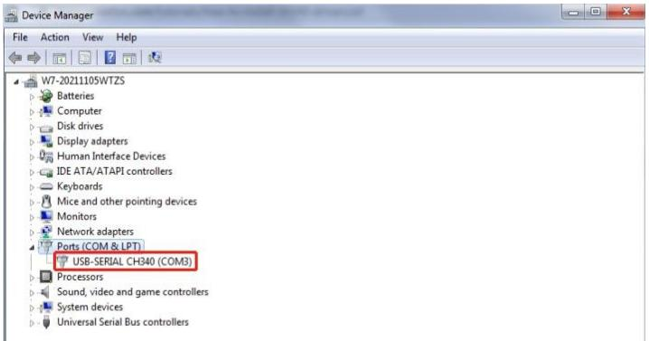

在下载的 PC 软件包中，打开 **WitMotion.exe** 软件。

软件下方会显示 Witmotion 软件支持的所有传感器型号。我们需要选择对应的传感器型号，然后将 Witmotion 软件与传感器连接。此处选择 **WT901WIFI** 型号。

注意区分 WIFI 的新旧版本：旧版 WIFI 型号为 WT901WIFI（旧版本），传感器标签上的设备号以 **WT53** 开头；新版本以 **WT55** 开头。

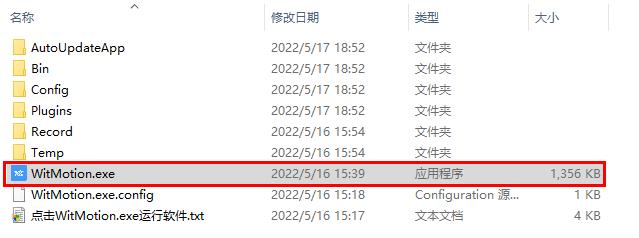

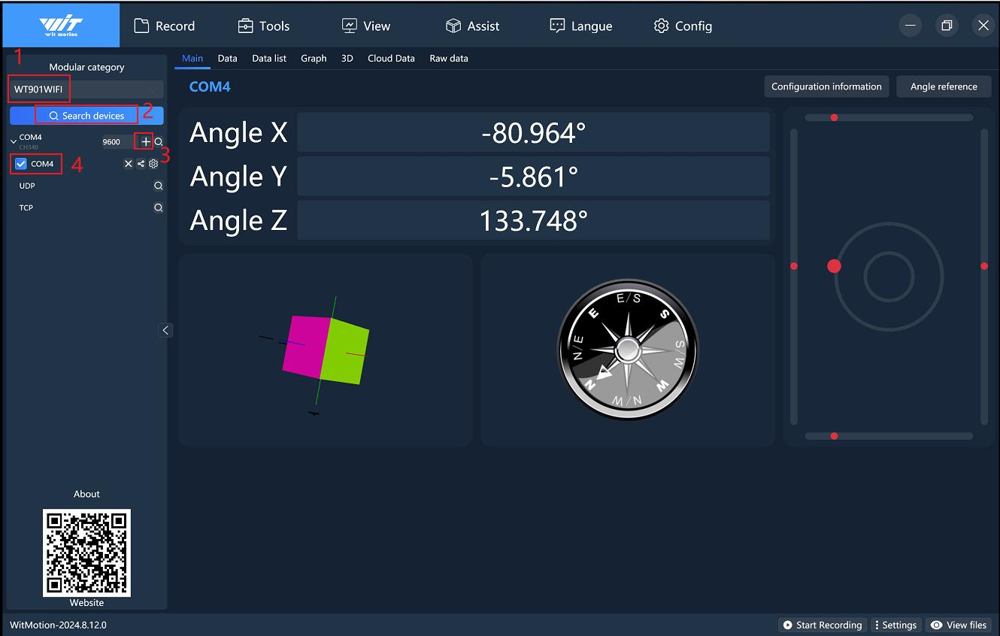

### 2.3 传感器组网

#### 2.3.1 AP 模式（路由模式）

在 AP 模式下，传感器自身会创建一个以设备号命名的热点。（注意：传感器只能选择一种协议模式）

传感器在 AP 模式下创建的 WIFI 热点如下图所示：

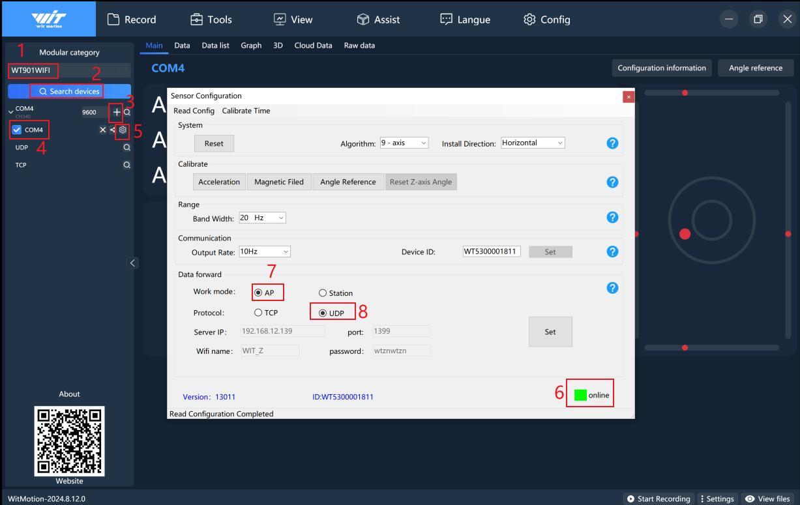

##### 2.3.1.1 UDP 协议

传感器创建一个以设备 ID 命名的 WIFI。电脑连接到该 WIFI 热点，连接成功后，传感器会给电脑分配一个 IP。此时传感器作为 Client 主动连接 Server（Witmotion 软件），建立 UDP 连接，并向 Witmotion 软件发送数据（AP 模式下只能发送给 Witmotion 软件）。

##### 2.3.1.2 TCP

传感器创建一个以设备 ID 命名的 WIFI。电脑连接到该 WIFI 热点，连接成功后，传感器会给电脑分配一个 IP。此时传感器作为 Client 主动连接 Server（Witmotion 软件），建立 TCP 连接，并向 Witmotion 软件发送数据（AP 模式下只能发送给 Witmotion 软件）。

完成以上任一设置后，请再次点击 **"Search Device"（搜索设备）**，并选择对应的 TCP/UDP 设备，如下图所示：


#### 2.3.2 站点（Station）模式

在 Station 模式下，传感器需要连接到外部 WIFI 网络。**电脑的 WIFI 名称和密码必须与传感器的 WIFI 名称和密码相同**，如下所示，否则连接会失败。

（注意：传感器只能选择一种协议模式）

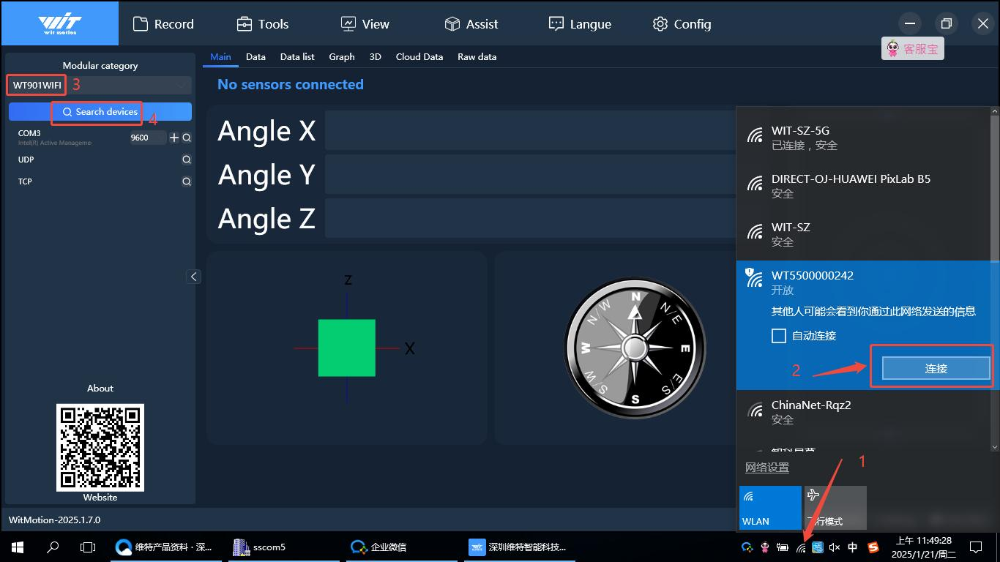

##### 2.3.2.1 UDP 协议

###### 2.3.2.1.1 指定 Witmotion 软件

输入 WIFI 名称和密码（输入后请再次核对）、IP（可选）和端口（Witmotion 软件的端口为 1399）。电脑和传感器需要连接在同一个局域网 WIFI 下。点击设置后，再次点击 **"Search Device"**。此时 Witmotion 软件会广播自己的 IP，连接到同一局域网的传感器会收到 Witmotion 软件发出的 IP。然后传感器会作为 Client，按照指定的 IP 连接 Server（Witmotion 软件），建立 UDP 连接并向 Witmotion 软件发送数据。操作如下图所示：

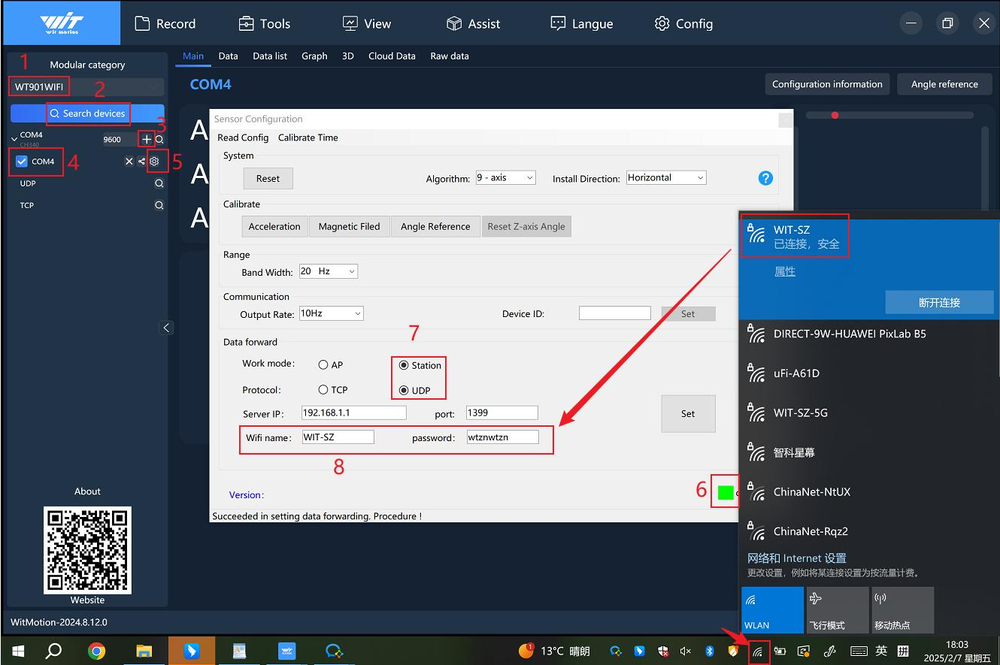

###### 2.3.2.1.2 指定用户服务器

输入 WIFI 名称和密码（输入后请再次核对）以及 IP（用户服务器 IP）和端口（用户服务器端口）。点击 Set 后，传感器会作为 Client，按照指定的 IP 连接用户的服务器，建立 UDP 连接并发送数据。

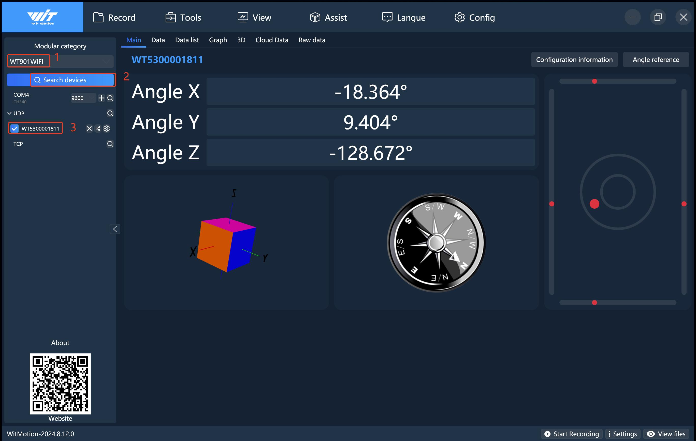

> **注意**：如果以上两种连接操作中出现设备搜索不到或无法连接的情况，可能是 WIFI 参数或 IP 参数不正确。请连接串口进行有线配置，或**长按按键 2 秒**恢复到 AP 模式并重置 WIFI 和 IP。

##### 2.3.2.2 TCP

###### 2.3.2.2.1 指定 Witmotion 软件

在 AP 模式下，如果你想改为 Station 模式并在 Witmotion 软件中显示数据，**不建议直接改为 TCP**。建议先在 Station 模式下改为 UDP；因为此时如果改为 TCP，生成的 WIFI 会断开，而电脑的 IP 是未知的，因此无法知道 TCP 的 IP。一旦随意设置，传感器将无法连接，Witmotion 软件将没有数据且无法恢复。此时只能重新连接串口进行配置，或长按按键 2 秒恢复到 AP 模式并重新设置 WIFI 和 IP。具体步骤如下：

- 在 AP 模式下，将其设置为 Station 模式 UDP 连接（UDP 无需建立连接即可广播，因此可以通过广播通知传感器连接哪个 IP；TCP 则不行，因此不建议在 Station 模式下直接从 AP 改为 TCP）；

- 将电脑连接到与传感器相同的 WIFI；

- 搜索并选择设备；

- 显示数据并进行配置；

- 查看当前电脑 IP：在命令窗口中输入 `ipconfig /all` 并按回车。方法如下：

  在命令窗口中执行 `ipconfig /all`，即可看到本机 IP 地址。

- 设置为 Station 模式 TCP 连接，填入你查到的本机 IP 地址，端口 1399；

- 搜索设备、选择设备，并显示数据。

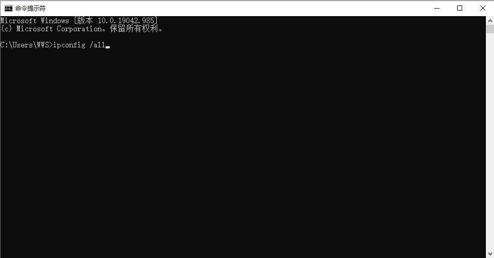

###### 2.3.2.2.2 指定用户服务器

输入 WIFI 名称和密码（输入后请再次核对）以及 IP（用户服务器 IP）和端口（用户服务器端口）。点击 Set 后，传感器会作为 Client，按照指定的 IP 连接用户的服务器（请确保服务器端 TCP-Server 已开启，否则传感器将无法连接），建立 TCP 连接并发送数据。

> **注意**：如果以上两种连接操作中出现设备搜索不到或无法连接的情况，可能是 WIFI 参数或 IP 参数不正确。请连接串口进行有线配置，或**长按按键 2 秒**恢复到 AP 模式并重置 WIFI 和 IP。

---

## 3. Witmotion 软件说明

### 3.1 菜单栏说明

**Record（记录）**：主菜单的录制功能选项，包含录制数据、查看记录文件保存目录、Play 文件回放、Witt 协议回放等功能。

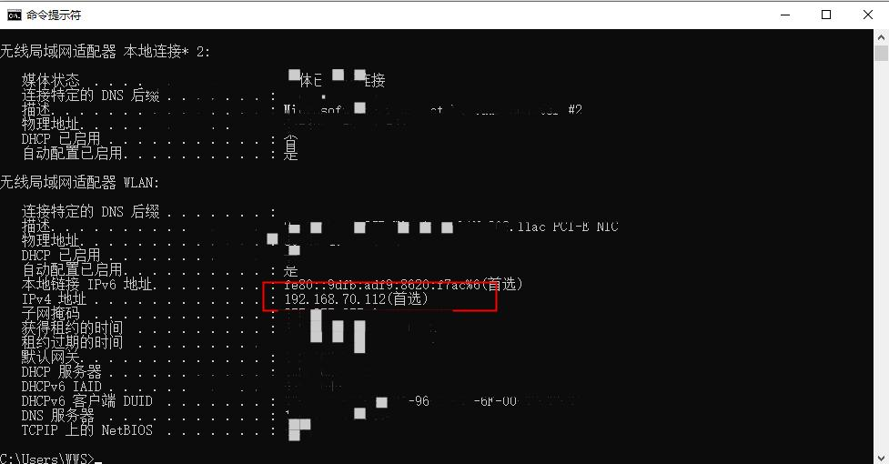

**Tools（工具）**：主菜单的工具功能选项，包含计算器、ISP 升级工具、固件升级等功能。

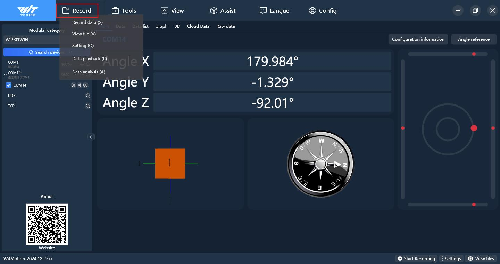

**View（视图）**：主菜单的视图功能选项，有三种页面显示风格可供选择，即精简风格、默认风格和暗色风格。

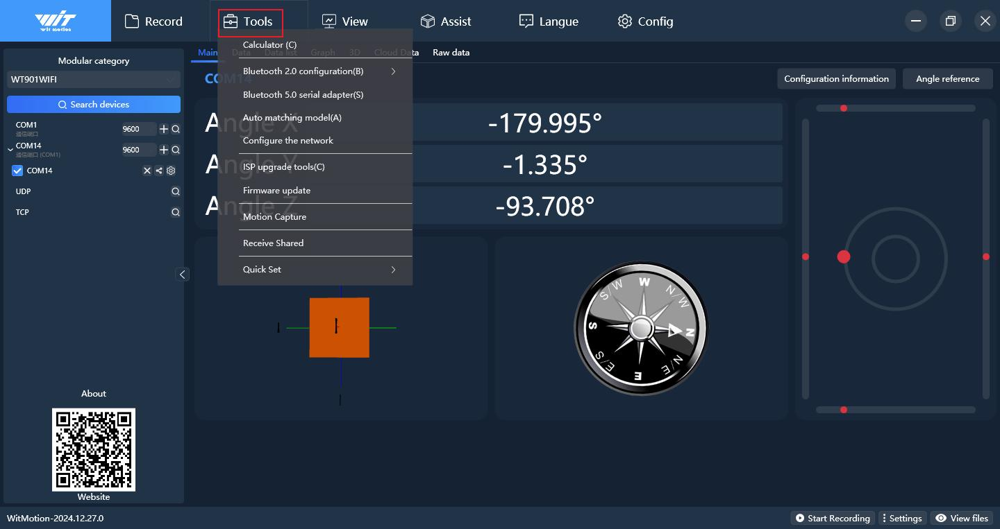

**Assist（帮助）**：主菜单的帮助功能选项，包含开发者、Witmotion 软件数据源、环境设置、检查更新等功能。

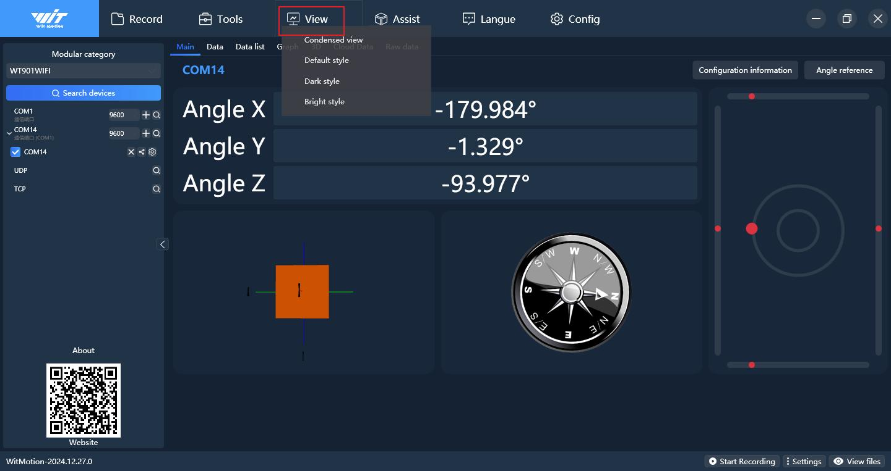

**Langue（语言）**：主菜单的语言功能选项，有中文和英文两种语言显示选项。

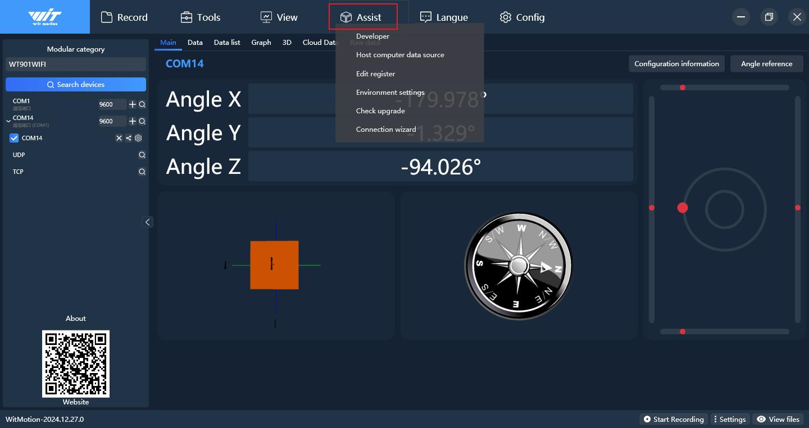

**Configuration（配置）**：主菜单的配置功能选项，包含各种传感器设置功能，可以调整传感器配置以更好地满足使用需求。

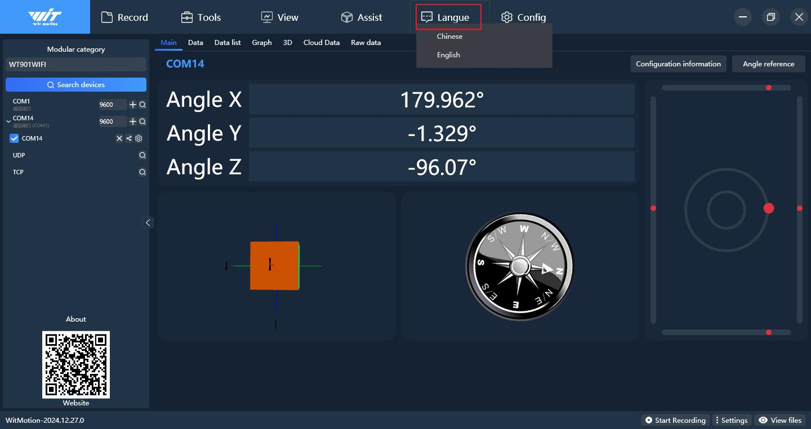

### 3.2 界面说明

主界面包含：数据网格、数据列表、曲线图表、3D 姿态、原始数据。

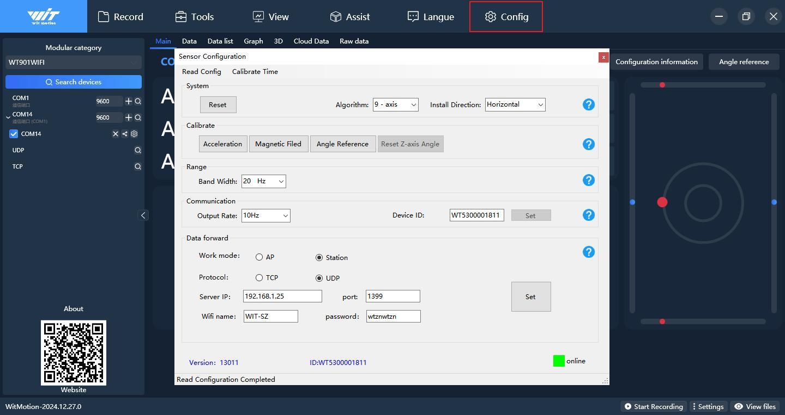

**数据网格**是主界面的数据展示效果。它整合了传感器的所有数据，能够更全面、直观地呈现传感器数据。

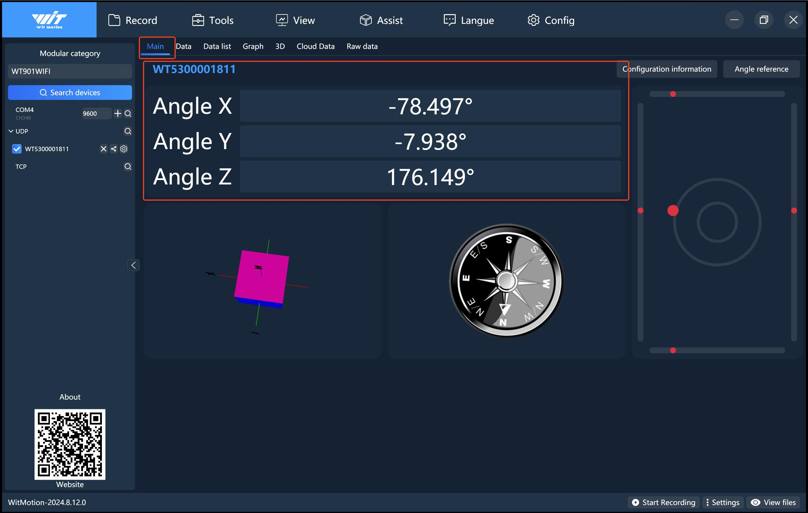

**曲线图**有三种展示效果，即加速度曲线、角速度曲线、角度曲线和磁场曲线。

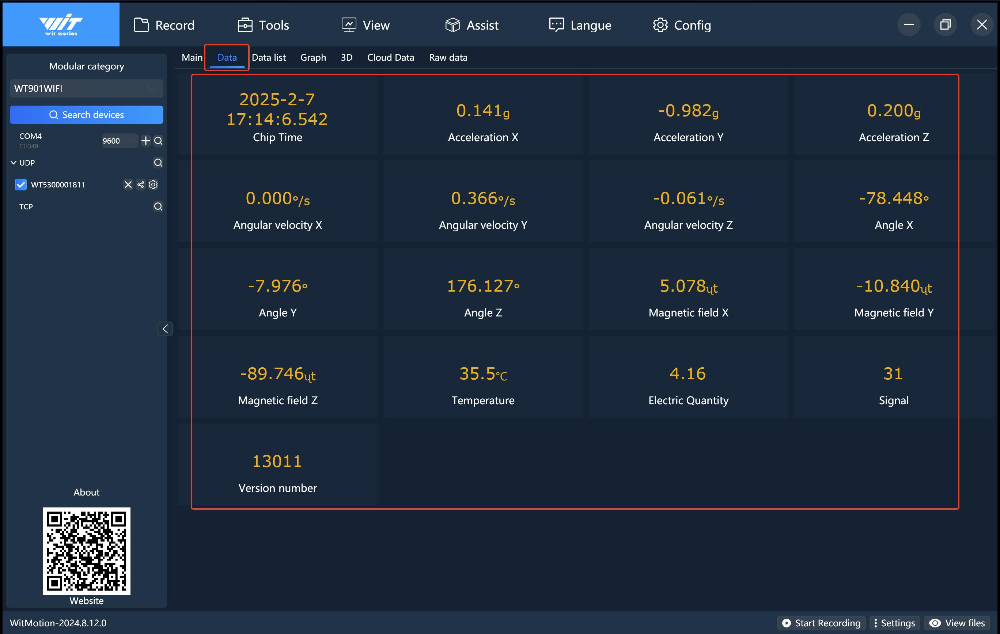

**3D 姿态**展示效果中，3D 模型会随着三轴角度的变化而改变显示方向；3D 姿态显示区域右侧有四种 3D 模型可以切换，可以点击 +/− 按钮放大和缩小 3D 模型。
**注：必须要有 X、Y、Z 三个角度的数据输出才能显示。**

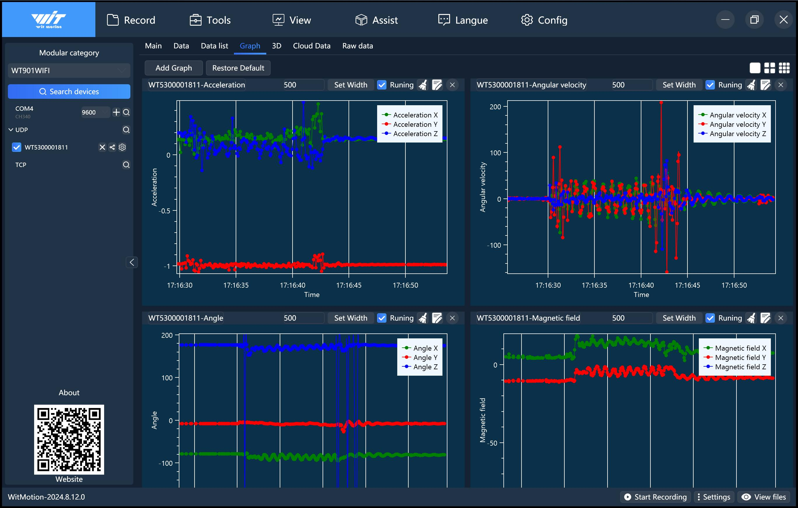

要查看传感器的版本号，需要先点击配置按钮。传感器版本号会显示在传感器配置窗口的左下角。
**注：需要在线才能读取版本号。**

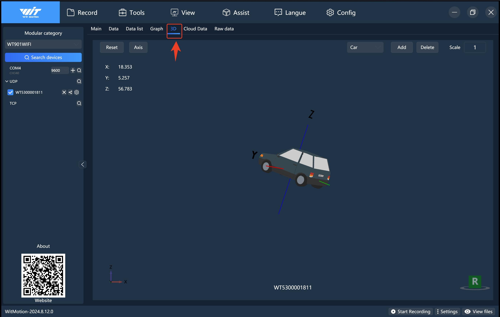

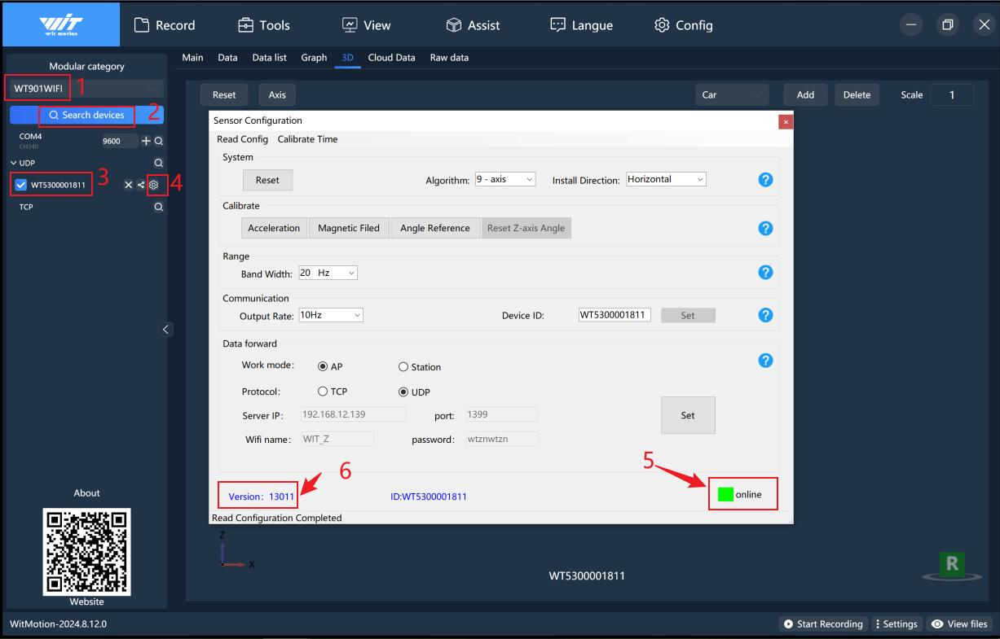

---

## 4. 传感器相关配置

### 4.1 传感器配置说明

点击此选项卡即可读取传感器配置。打开配置选项卡时，默认会读取模块配置。需要更改配置时，可以在更改完成后点击此选项卡，检查配置是否设置成功。
**注：需要在线才能读取配置。**

#### 4.1.1 读取配置

点击 **Read Configuration（读取配置）** 可重新读取配置页面数据并更新。

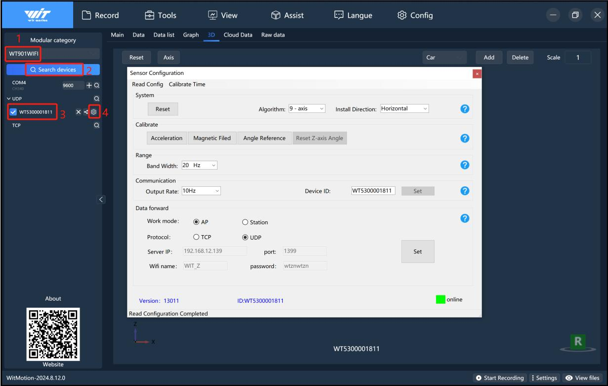

#### 4.1.2 校准时间

点击 **Calibrate Time（校准时间）** 会向传感器发送时间校准指令（设备连接时会自动发送，无需额外手动校准）。

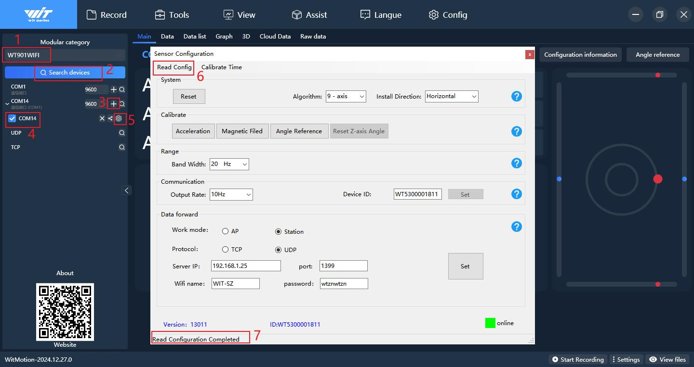

#### 4.1.3 恢复设置

点击 **Restore Settings（恢复设置）** 可将传感器恢复为出厂设置，这可能会导致当前连接断开。重新配置后，请重新搜索设备。

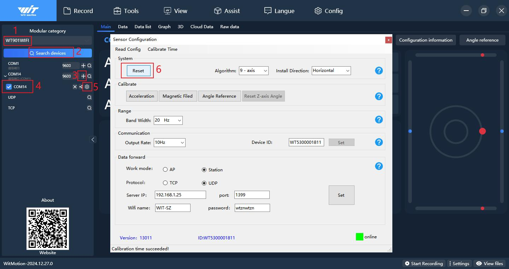

#### 4.1.4 算法

六轴传感器使用六轴算法，Z 轴角度主要基于角速度积分计算。

九轴传感器使用九轴算法。Z 轴角度主要基于磁场计算，不会产生漂移。当使用环境中存在磁场干扰时，可以尝试使用六轴算法来检测角度。

**如何从九轴算法切换到六轴算法**：在 Witmotion 软件的配置栏中将算法改为"六轴"（six-axis），然后执行加计校准和 Z 轴归零校准。校准完成后即可正常使用。

> **注意**：只有九轴传感器才能切换算法，系统默认为九轴算法。六轴传感器无法切换算法。

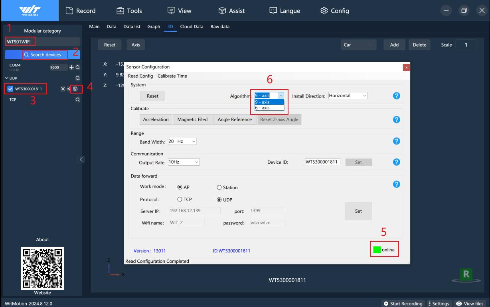

> **注意**：Z 轴归零仅对六轴算法有效。将九轴传感器切换为六轴算法后，即可实现 Z 轴归零。
>
> 九轴传感器在九轴算法下的 Z 轴角度是**绝对角度**，以**东北天**为坐标系，无法相对归零到 0。

#### 4.1.5 安装方向

模块默认的安装方向为水平安装。当模块需要垂直放置时，可以使用垂直安装设置。

**垂直安装方法**：垂直安装时，将模块绕 X 轴旋转 90°，使其垂直向上放置。在 Witmotion 软件配置栏的 **"Installation Direction"（安装方向）** 选项中选择 **"Vertical"（垂直）**。设置完成后，需要先进行校准才能使用。

模块默认水平安装。当模块需要垂直安装时，可以使用垂直安装设置。

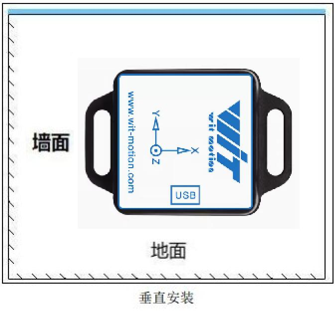

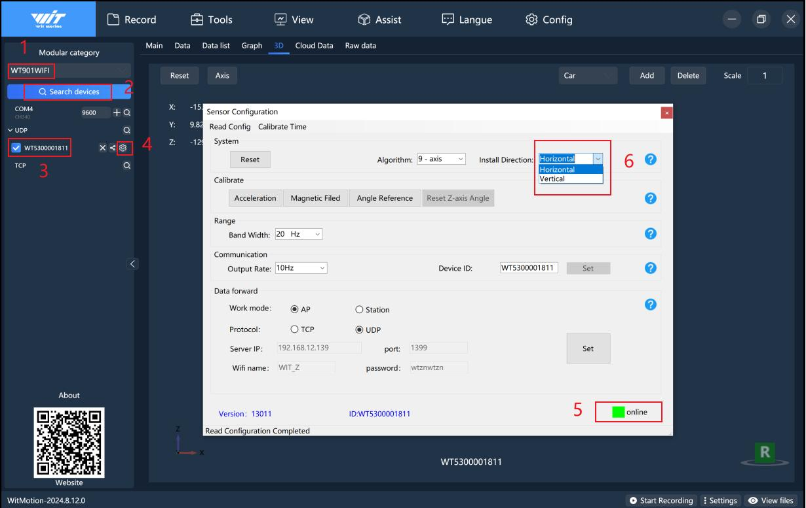

### 4.2 传感器校准

#### 4.2.1 加速度校准

**加速度计校准**：用于消除加速度计的零偏。传感器出厂时会存在不同程度的零偏误差，需要手动校准才能实现精确测量。

**加计校准方法**：

首先保持模块水平静止，点击传感器配置窗口下方校准栏中的"加速度"（Acceleration），1～2 秒后，模块三轴的加速度值将约为 0、0、1，X、Y 轴角度将约为 0°。校准后，XY 轴角度会更加准确。

> **注**：当 Z 轴水平静止时，存在 1G 的重力加速度。

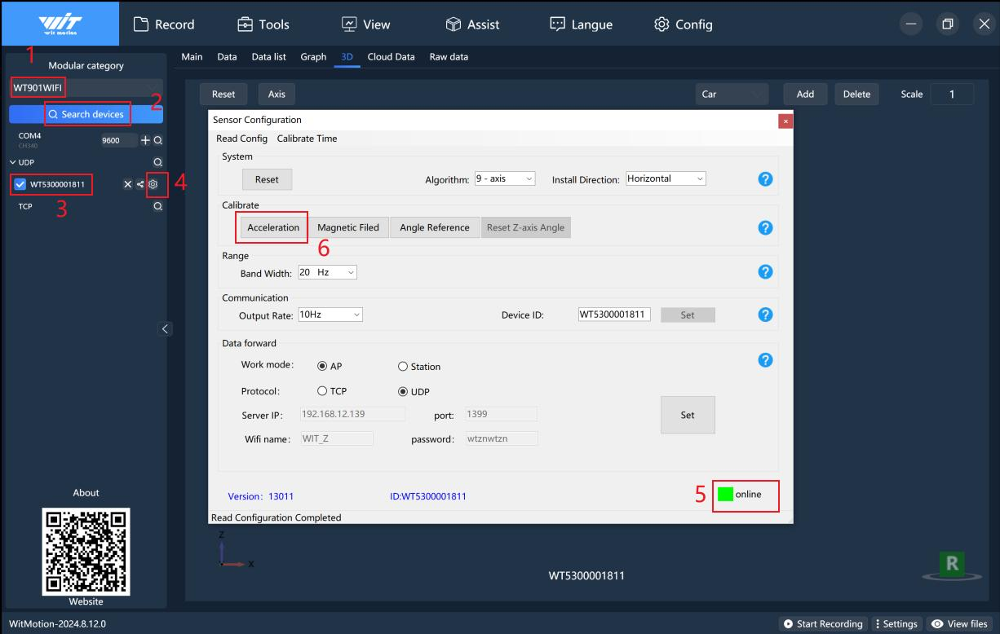

#### 4.2.2 磁场校准

> 原文此节只有标题和一张界面截图，没有正文说明。

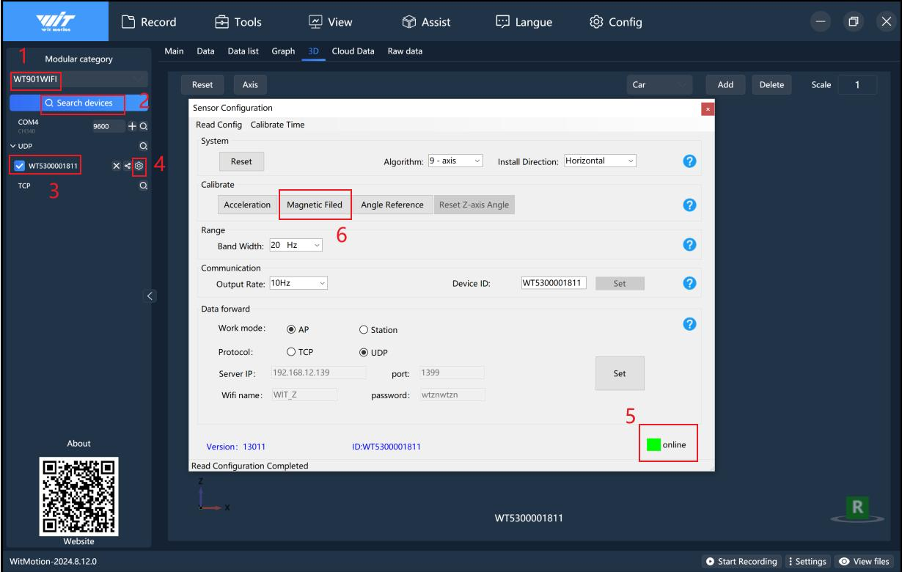

#### 4.2.3 Z 轴归零

点击 **Z-axis zero（Z 轴归零）** 会将当前 Z 轴的校准值设为 0 度（**仅在六轴算法下配置时有效**）。

#### 4.2.4 角度参考

点击 **Angle Reference（角度参考）** 会将传感器当前的 X、Y 角度设为 0 度。

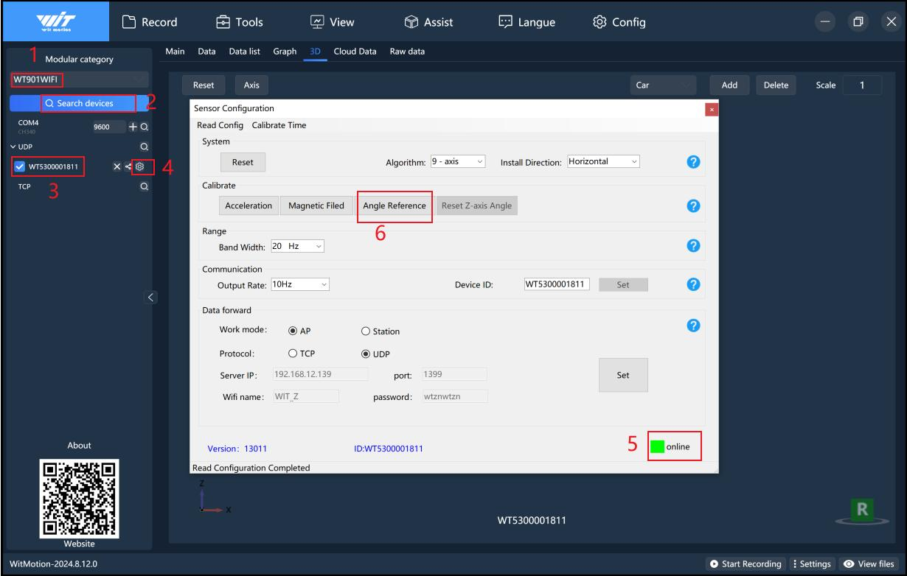

### 4.3 量程与通信

#### 4.3.1 带宽

**带宽的含义：**

带宽指的是被测物体变化的最大速度，单位为 Hz，也就是 1 秒内变化的次数。如果被测物体的运动变化非常快，就需要较高的带宽，否则可以降低带宽。

高带宽可以使数据响应更快、更及时，但会带来更大的测量噪声。低带宽可以使测量数据更平滑，滤除大部分高频噪声，但问题是响应会有延迟，适用于被测物体运动缓慢、不需要快速响应变化的情况。

如果数据输出速率高于带宽，可能会出现重采样现象，即两个或多个相邻数据完全相同。

总结如下：

| | 高带宽 | 低带宽 |
| --- | --- | --- |
| 数据平滑度 | 不平滑 | 平滑 |
| 噪声 | 大 | 小 |
| 响应速度 | 快 | 慢 |

**设置方法：**

在 Witmotion 软件配置栏中设置。默认值为 20Hz，可适应大多数测量场合。

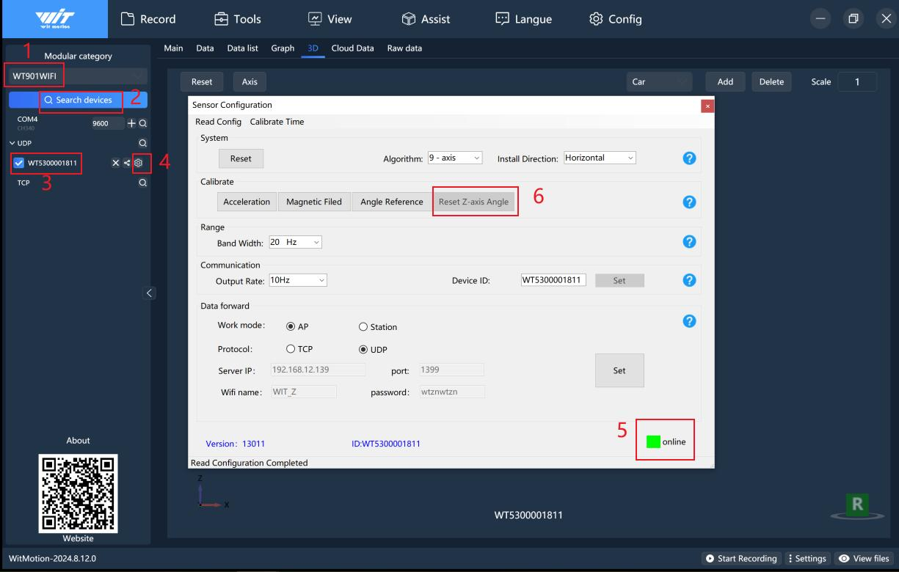

#### 4.3.2 回传速率

**设置方法**：点击 Witmotion 软件配置选项，在配置栏中选择 1～200Hz 的回传速率。

模块默认回传速率为 **10Hz**，支持的最大回传速率为 **200Hz**。

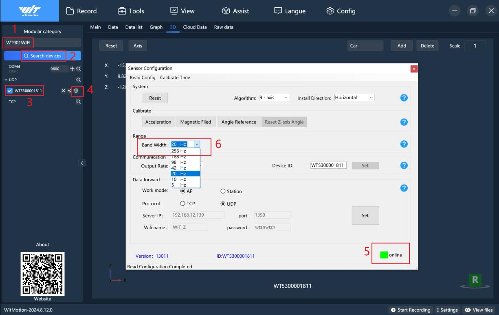

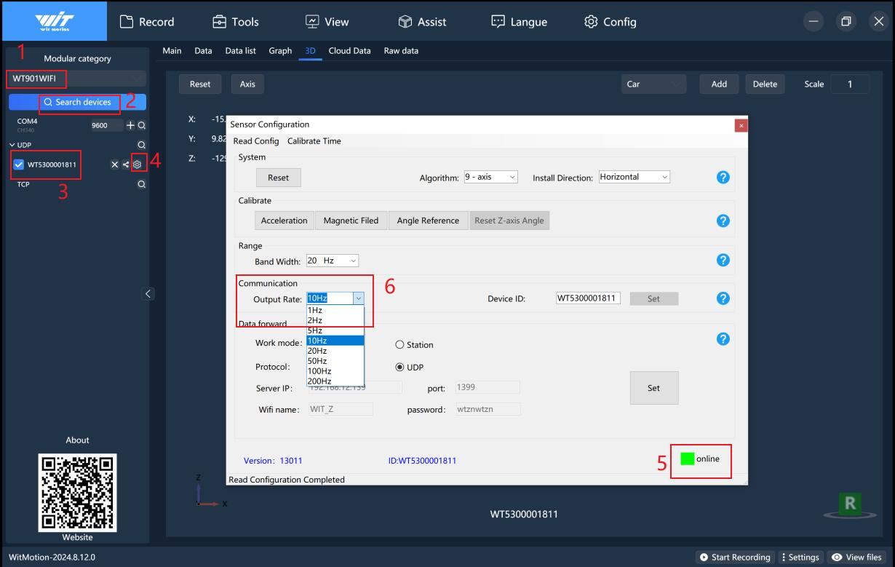
